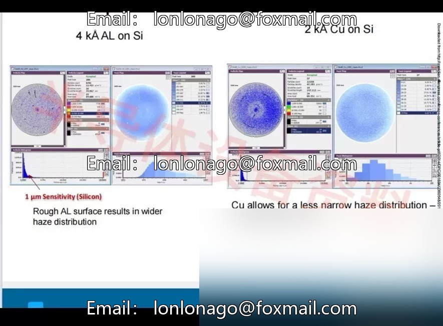
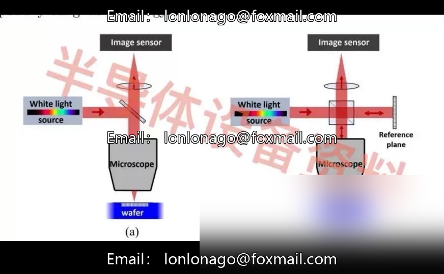
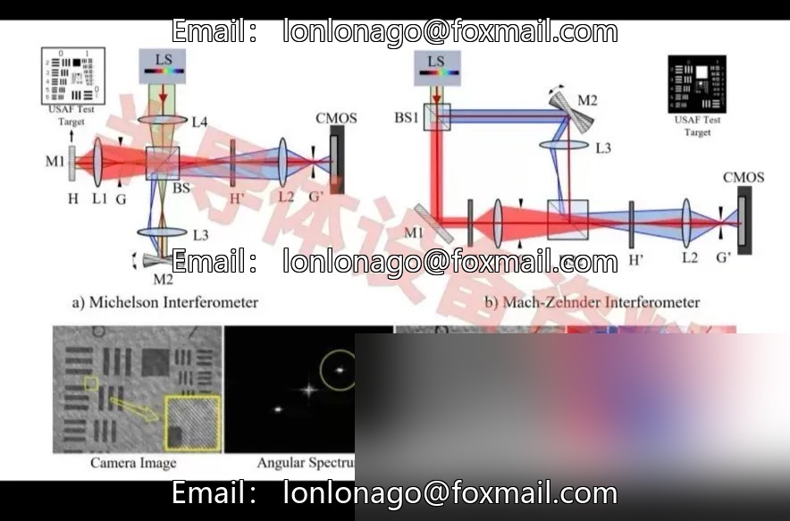
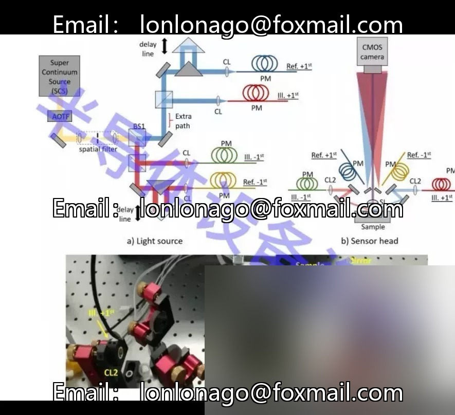
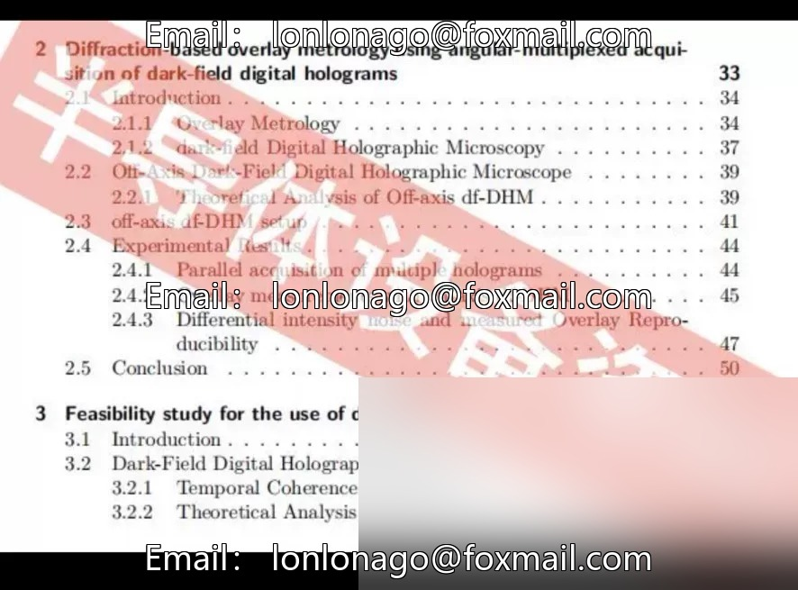
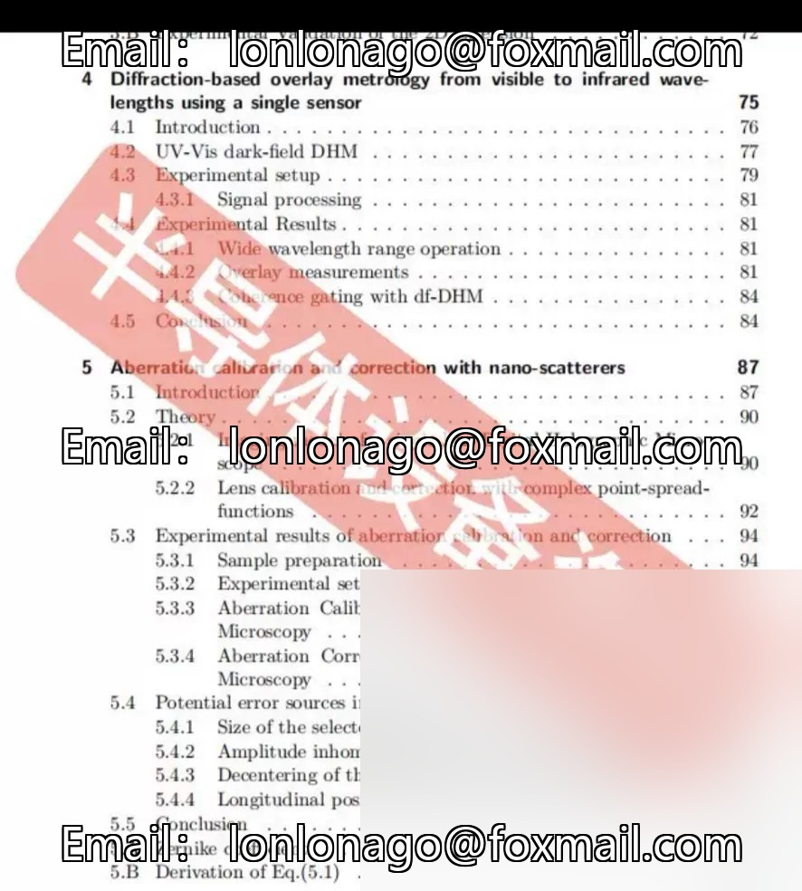

# Wafer detection equipment technology: Application technology of on-disk measurement dark-field holography - Based on LuDao

## Body

Wafer detection equipment technology: Application technology of wafer measurement dark-field holography - based on Rudolph dark-field laser technology - wafer particle technology technology and more! Within 200 pages, all core technologies! Recommend!!!

Capture and send the electronic original directly! The following images include screenshots of the file portion. Please confirm before placing the order! Due to the replicable nature of electronic documentation Therefore, are allowed after purchase! Thanks for understanding!

For personal learning and reference use only.

The technology covers dark-field holographic application in wafer testing equipment, based on Ruldov dark-field laser and wafer particle technology, with a large volume of core technical content and electronic original files along with some screenshots.

<!-- AI_ENRICHED -->

## Images

## Payment

Here is a pay link on Stripe ( https://buy.stripe.com/3cs8yP7sY87d0vu9AB ). Please contact me lonlonago@foxmail.com after funding $89, and I will send you a complete data files , thank you!

